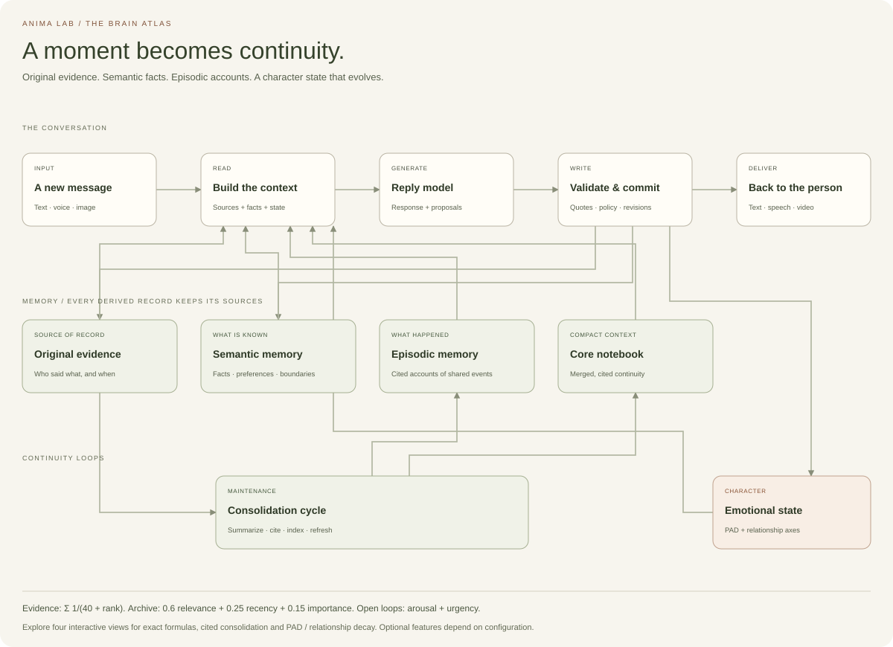
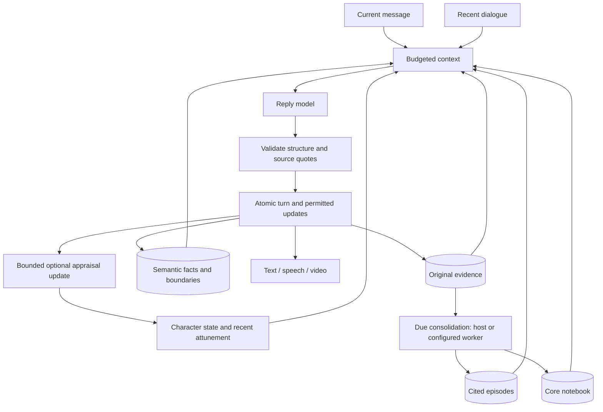

# Inside the companion brain



Start [Companion Studio](../examples/showcase/README.md) and open **[the interactive Brain Atlas](http://127.0.0.1:8787/?view=architecture)**. Its four views cover the turn lifecycle, retrieval, consolidation and emotional continuity. Play a sequence, step through it, or change the illustrative formula inputs. The page is public static content: it makes no model calls and reads no private conversations. Reduced-motion mode disables playback; all controls remain usable with a keyboard.

This documents the **standalone Python implementation**, adapted from selected Anima designs. It does not call Anima’s Convex backend or claim identical behavior to the production app. Animation examples are fictional, not measurements of a running character.

**简体中文：** [中文静态图](assets/brain-flow.zh-CN.svg) · [中文动图](assets/brain-flow.zh-CN.gif) · [中文交互页](http://127.0.0.1:8787/?view=architecture&lang=zh-CN)。交互页可切换语言；两版共用流程、连线与公式实现，本文详细技术说明为英文。

## 1. One conversation, distinct kinds of memory

| Representation | What it holds | What it is for |
| --- | --- | --- |
| **Original evidence** | Exact message, speaker, observation timestamp and source ID | Check what was actually said. Summarization preserves originals; explicit deletion is a separate operation. |
| **Semantic memory** | Current facts, preferences and boundaries, with source quotes, revisions and temporal metadata | Know the current state of the world and distinguish changes from contradictions. |
| **Episodic memory** | Derived, cited accounts of events or exchanges | Recall what happened together without replaying the entire transcript. |
| **Core notebook** | Merged, cited continuity across episodes and current knowledge | Supply compact context. It is derived memory, not independent ground truth. |
| **Notes and links** | Descriptions, keywords and evidence associations | Improve lookup and source expansion; a retrieval hint is not original evidence. |
| **Open loops** | Facts marked `loop_status=open` and `followup=ask` | Prioritize unresolved things that might be relevant to the next reply. |
| **Recent dialogue** | A bounded window of recent exchanges | Preserve immediate conversational coherence. |
| **Character state / recent attunement** | Fictional PAD and relationship state / separate turn-specific interpretations and feedback | Carry tone and emotional continuity without turning a temporary user feeling into a fact. |

“Semantic” and “episodic” describe the role of these records, not two independent vector databases. Current facts live in `memories`; episodes and core records are `documents` with a `kind`. Original sources remain in `evidence`. Derived records have their own retrieval index alongside original-evidence search.

For example, **“The interview moved from Friday to Monday”** can update a semantic fact, contribute to an episodic account of interview preparation, and refresh the core notebook. It should not turn “I am stressed today” into an enduring personality label.



A source-quote check establishes provenance, not semantic truth. Automatic, review and off policies govern proposed fact changes. Corrections preserve revisions and source history. Optional reader follow-up tools can search and expand sources before the final reply.

## 2. Retrieval: relevance and recency are different scores

There is **no single “similarity + importance + recency” formula applied to all memories** in this SDK. The atlas exposes the actual separate paths.

### Evidence and derived-memory relevance

[`memory.py::recall`](../src/companion_engine/memory.py) searches original evidence; [`retrieval.py::search`](../src/companion_engine/retrieval.py) searches derived facts and documents. Each ranks its own pool:

1. FTS5 returns lexical candidates ordered by BM25.
2. Optional configured embeddings return candidates with positive cosine similarity. Vectors are normalized; the implementation computes their dot product. This is exact local vector search, not an ANN service.
3. Each available channel contributes up to 60 candidates. Derived-memory search also includes a bounded CJK substring channel.
4. Reciprocal rank fusion combines candidate ranks:

```text
RRF(item) = Σchannel 1 / (60 + rankchannel(item))
```

Ranks start at 1. An item absent from a channel gets no contribution from it. An item ranked 1 by keywords and 4 by vectors scores `1/61 + 1/64 = 0.03202`. Without the vector match it scores `1/61 = 0.01639`. This is a ranking score, **not a probability**.

RRF has no age, importance or emotion multiplier. Original recall can filter **observation dates**, which are not event dates. Event dates and fact validity use separate [temporal lookup](../src/companion_engine/temporal.py).

### Open-loop priority: importance, arousal, age and date urgency

[`memory.py::loops`](../src/companion_engine/memory.py) selects up to 12 eligible open follow-up items:

```text
priority = I × (1 + A) × exp(−t / (14 + 30A)) + U

I = importance, integer 1…10
A = stored arousal, 0…1
 t = max(0, now − updated_at) / 86,400  [days]
U = 2 / (1 + |event_date − local_today|), if an event date exists
    0 otherwise
```

Here, arousal is a memory-detail field, not the character’s current PAD arousal. Higher arousal increases weight and slows age decay. `14 + 30A` is an exponential **time constant**, not a half-life. Event urgency is symmetric around today: an event yesterday and tomorrow get the same bonus.

With `I=7`, `A=0.5`, `t=0` and an event tomorrow, the score is `10.5 + 1 = 11.5`. With no event date it is `10.5`. After 90 days, with no event date, it is approximately `0.47`.

These items enter the next context; this function does not send proactive messages.

### Final context assembly

Rank is only part of inclusion. [`engine.py::prepare_turn`](../src/companion_engine/engine.py) also prioritizes pinned boundaries/styles and revised facts, adds core/documents, open loops and recent dialogue, and includes enabled character state. [Context policy](../src/companion_engine/context_policy.py) applies configured per-layer and total budgets. Whole entries may be omitted, with omission counts; this does not delete their stored sources.

The interactive retrieval sliders calculate these formulas on illustrative inputs. They do not tune the SDK’s configuration or alter retrieval behavior.

## 3. Consolidation is a cycle, not a destructive compression step

**Default policy for new/unconfigured companions:** host summaries and configured embedding/retrieval support are enabled. A host still has to perform the summary work; embedding needs a provider. Background model summaries are an explicit alternative, mutually exclusive with host summaries. These defaults are defined in [`automation.py::default_policy`](../src/companion_engine/automation.py).

With summary work enabled, the default due thresholds are:

- 4 unprocessed committed turns; **or**
- 12,000 characters in the unprocessed evidence; **or**
- 300 seconds idle since the newest pending evidence.

Host mode also treats unprocessed knowledge changes as a trigger. “Due” is a notice, not proof that work ran. An active host or running worker must act on it. Thresholds are configurable.

```mermaid
flowchart LR
    Backlog[Committed originals and knowledge updates] --> Due{Summary due?}
    Due --> Writer[Host OR configured background model]
    Writer --> Snapshot[Read sources and current facts]
    Snapshot --> Draft[Episode plus merged core]
    Draft --> Validate[Validate citations and unchanged snapshot]
    Validate --> Commit[Commit summaries and mark processed]
    Commit --> Index[Refresh search and optional vectors]
    Index --> Recall[Future context]
    Change[Fact corrected or deleted] --> Invalidate[Invalidate core and affected documents]
    Invalidate --> Backlog
```



Host summaries use `prepare_memory_summary` and `commit_memory_summary`. The host writes a batch episode and merged structured notebook, with a snapshot ID and cited source IDs. A changed snapshot must be reread. At most one host batch is requested per conversational turn. Background `maintain()` is a different bounded path, processing up to eight original excerpts per batch.

Both paths preserve the originals. Current core is replaced, episodes are added, and processed source markers prevent blindly repeating work. Character self-core is optional and separate from user knowledge. Notes and evidence links can improve retrieval; vectors are namespaced and invalidated when the corresponding content changes.

When a fact changes, current core and documents citing the affected source are invalidated; if no source turn is available, invalidation is broader. New summaries must respect knowledge updates so deleted, corrected or superseded claims are not revived as current facts. Provenance checks do not independently verify every model inference.

Sources: [`host_memory.py`](../src/companion_engine/host_memory.py), [`memory.py::consolidate_pair`](../src/companion_engine/memory.py), [`engine.py::_invalidate_documents`](../src/companion_engine/engine.py), [`runtime.py::maintain`](../src/companion_engine/runtime.py).

## 4. Emotion: fast mood and slower relationship state

This is **fictional character-writing state**, not a clinical model of the user. An attunement record describes the current user cue and response intention separately; appraisal proposes changes to the character.

### Time decay

For elapsed hours `h`, before new appraisal and daily weather:

```text
PAD(h) = baseline + (PAD₀ − baseline) × 2^(−h / 12)
baseline = (pleasure=0.15, arousal=−0.15, dominance=0.05)

tension(h) = tension₀ × 2^(−h / 72)
```

PAD deviation halves every **12 hours**, tension every **72 hours**. At 12 hours, 50% of the original PAD deviation and approximately 89.1% of tension remain. The interactive chart isolates these two decay rules.

Warmth above `0.6 × familiarity` begins cooling after seven days without interaction, with a 35-day half-life for the excess. Seeded daily weather adds small pleasure/arousal offsets once per UTC day during preparation. Neither effect is included in the isolated chart.

### Appraisal and bounded updates

An appraisal chooses one of 12 emotion targets and an intensity. Its PAD pull is:

```text
pull = 0.3 × intensity / 3
PAD_next = PAD_decayed + pull × (emotion_target − PAD_decayed)
```

Five relationship axes are tracked: **trust, warmth, familiarity, tension, romance**. Their update rules include:

- Positive warmth is divided by `1 + 0.6 × repeat_count`; trust loss has an asymmetric multiplier.
- After axis-specific scaling, the state-dependent delta is `units × 0.013 × (1 − 0.75v)` for positive units and `units × 0.013 × (0.25 + 0.75v)` otherwise.
- The resulting delta is limited by the remaining **0.12 total absolute movement budget per axis per UTC day**; values are clamped to `[0,1]`.
- Romance growth requires opt-in and familiarity above `0.2`, evaluated after this turn’s familiarity movement.
- Relationship bands use a `0.035` hysteresis margin to reduce abrupt label switching.

These rules feed a state note into the next reply; they never override a current boundary. Read [`emotion.py`](../src/companion_engine/emotion.py) for the complete axis multipliers and state transitions.

## 5. Where to inspect or extend it

| Responsibility | Implementation |
| --- | --- |
| Public API and configuration | [`brain.py`](../src/companion_engine/brain.py), [`sdk_models.py`](../src/companion_engine/sdk_models.py) |
| Reply orchestration and delivery | [`runtime.py`](../src/companion_engine/runtime.py), [`generation.py`](../src/companion_engine/generation.py), [live calls](live-calls.md) |
| Original evidence and open-loop ranking | [`memory.py`](../src/companion_engine/memory.py) |
| Facts / episode / core search | [`retrieval.py`](../src/companion_engine/retrieval.py) |
| Context and transaction boundaries | [`engine.py`](../src/companion_engine/engine.py), [`context_policy.py`](../src/companion_engine/context_policy.py) |
| Consolidation scheduling and writers | [`automation.py`](../src/companion_engine/automation.py), [`host_memory.py`](../src/companion_engine/host_memory.py) |
| Emotion formulas | [`emotion.py`](../src/companion_engine/emotion.py) |
| Atlas data and interactive UI | [`brain-flow.json`](assets/brain-flow.json), [`Architecture.tsx`](../examples/showcase/src/Architecture.tsx) |

All four graph views and English explanations are stored in versioned JSON. Chinese text lives in [`brain-flow.zh-CN.json`](assets/brain-flow.zh-CN.json), keyed by the same view/node IDs and step order. Both languages reuse the graph layout and formula implementation. Each static SVG uses the overview; each GIF records all four interactive chapters. Regenerate them with:

```bash
python scripts/render_brain_diagram.py
python scripts/render_brain_diagram.py --lang zh-CN
# Start the showcase first; ffmpeg and showcase npm dependencies are needed.
node examples/showcase/scripts/render-architecture.mjs http://127.0.0.1:8787
node examples/showcase/scripts/render-architecture.mjs http://127.0.0.1:8787 --lang zh-CN
```

The showcase remains optional and separate from the headless Python SDK. Editing these visual examples does not alter memory or emotion algorithms.
